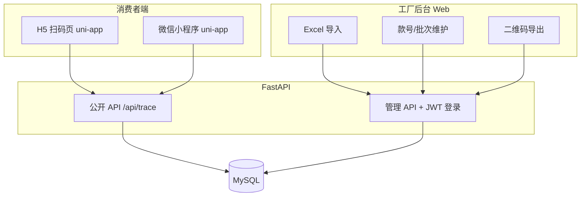
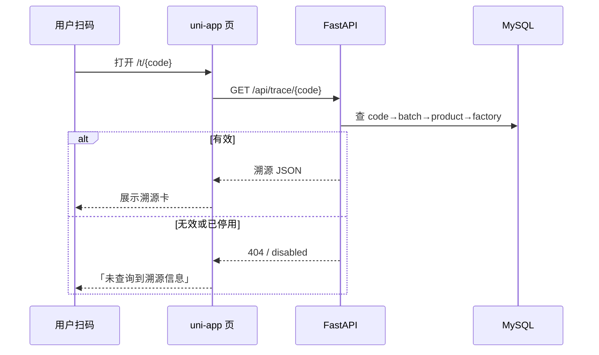

# 服装二维码溯源系统 — 设计规格

- **日期**：2026-10-01
- **状态**：已确认（方案 A：最小可投标 MVP）
- **场景**：服装厂招标，消费者扫描吊牌二维码后查看生产厂家、生产地址等基础溯源信息

---

## 1. 目标与非目标

### 目标

1. 为每款/每批服装生成唯一溯源二维码，印于吊牌。
2. 消费者通过 **H5 或微信小程序** 扫码查看基础溯源信息。
3. 工厂通过 **轻量后台** 以 Excel 导入或手动方式维护溯源数据并导出码图。
4. 单工厂单租户交付；数据模型预留多租户扩展。
5. 可作为投标演示与一期交付物。

### 非目标（MVP 不做）

- 一物一码（每件单品）、RFID/NFC
- 防伪校验、防窜货、扫码营销
- 扫码统计与用户画像
- 多工厂入驻、计费
- 审批流、多角色权限

---

## 2. 已确认决策

| 项 | 决策 |
|----|------|
| 交付形态 | 自建（非 SaaS 采购） |
| 消费者端 | H5 + 微信小程序双端 |
| 溯源深度 | 基础档（厂家、地址、日期、批次、成分、标准、检验员等） |
| 租户 | 单租户 + 预留扩展 |
| 赋码粒度 | 一批一码 / 一款一码 |
| 工厂后台 | 轻量导入（Excel）为主 |
| 前端技术 | uni-app（一套代码双端） |
| 后台技术 | Vue 3 + Vite |
| 后端技术 | Python FastAPI |
| 架构 | 方案 A：最小可投标 MVP |
| 目录 | 按端分目录：`client/` `admin/` `server/` `docs/` |

---

## 3. 总体架构



### 仓库结构

```
/
  client/     # uni-app 双端（H5 + 微信小程序）
  admin/      # 工厂轻量后台（导入/维护/导出码）
  server/     # FastAPI + 数据访问
  docs/       # 设计与投标说明
```

### 组件职责

| 组件 | 职责 | 依赖 |
|------|------|------|
| `client/` | uni-app 溯源展示页，条件编译出 H5 / 微信小程序 | 公开 API |
| `admin/` | 登录、Excel 导入、款/批次维护、导出码图（Vue 3 + Vite） | 管理 API |
| `server/` | 生码、查询、导入校验、鉴权 | MySQL |
| MySQL | 工厂、产品、批次、码映射、后台用户 | — |

---

## 4. 数据模型

单租户实现；业务表均带 `factory_id`，便于二期多租户。

| 表 | 关键字段 | 说明 |
|----|----------|------|
| `factories` | id, name, address, license_no, contact | 工厂主体（当前仅 1 条） |
| `products` | id, factory_id, style_no, name, category, composition, standard_no, image_url | 款号/产品 |
| `batches` | id, product_id, batch_no, production_date, inspector, workshop, extra_json | 批次（一码一档） |
| `trace_codes` | id, code, batch_id, status, created_at | 短码 ↔ 批次 |
| `users` | id, username, password_hash, role | 后台登录 |

约定：

- **一码一档**：`trace_codes.code` → `batches` → `products` → `factories`
- `extra_json` 承载客户临时扩展字段
- 短码：≥8 位随机字母数字，足够熵，降低撞库
- `trace_codes.status`：`active` / `disabled`

---

## 5. 扫码流程



### 消费者端展示字段（基础档）

1. 品牌 / 工厂名称
2. 生产厂家、生产地址
3. 款号、品名、成分
4. 生产日期、批次号、检验员
5. 执行标准
6. 页脚：查询说明 + 工厂联系方式（可选）

URL 形态：`https://{domain}/t/{code}`（H5）；小程序路径 `pages/trace/index?code={code}`。

---

## 6. 后台（admin/）范围

| 功能 | 说明 |
|------|------|
| 登录 | 账号密码，JWT，仅工厂管理员 |
| Excel 导入 | 上传 xlsx，校验后批量入库并自动生码 |
| 列表维护 | 款/批次查询、启停用码、编辑允许字段 |
| 导出 | 按批次导出二维码 ZIP（PNG）或吊牌 PDF |
| 明确不做 | 扫码统计、审批流、多角色 |

### 导入模板列

```
style_no, name, composition, standard_no,
batch_no, production_date, inspector,
factory_name, factory_address
```

---

## 7. API 摘要

| 方法 | 路径 | 说明 |
|------|------|------|
| GET | `/api/trace/{code}` | 公开查询，返回溯源卡数据 |
| POST | `/api/admin/login` | 登录，返回 JWT |
| POST | `/api/admin/import` | Excel 导入（事务） |
| GET | `/api/admin/batches` | 批次列表 |
| PATCH | `/api/admin/codes/{id}` | 启停用码 |
| POST | `/api/admin/export` | 导出码图 |

统一响应：`{ "code": 0, "message": "ok", "data": {} }`。

---

## 8. 错误处理

| 场景 | 行为 |
|------|------|
| 未知 / 停用码 | 端上友好页「未查询到溯源信息」 |
| Excel 校验失败 | 返回行号 + 原因，整批事务不写库 |
| 重复款号 + 批次 | 默认拒绝，提示已存在 |
| 短码撞库 | 熵 ≥8 位随机；MVP 不做频次风控 |
| API 异常 | 统一错误结构；5xx 记服务端日志 |

---

## 9. 测试与验收

| 层级 | 内容 |
|------|------|
| API 单测 | 生码、查询、导入校验、启停用 |
| 契约 | `/api/trace/{code}` 响应结构固定，双端依赖 |
| E2E 手工 | 真实扫码见页面；错码见兜底文案 |
| 验收 | 导入 20 行样例 → 导出码 → 微信扫码信息一致 |

---

## 10. 里程碑（建议）

| 阶段 | 产出 |
|------|------|
| M1 | `server/` 数据模型 + 查询/导入 API + 单测 |
| M2 | `admin/` 导入与导出码图 |
| M3 | `client/` H5 溯源页 |
| M4 | 小程序端联调 + 真机扫码验收 |
| M5 | 投标演示包（截图、演示账号、方案说明） |

---

## 11. 后续扩展（不在一期）

- 扫码次数/地域统计
- 首次扫码正品提示、重复扫码提醒
- 多租户（工厂入驻、独立配置）
- 全链路工序、防伪、防窜货
